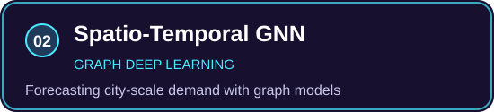

<!-- Douaa EL ARIF / Showcase-inspired original design. All hero graphics are self-contained. -->

  

  <a href="https://www.linkedin.com/in/douaa-e-71413223b/"><b>LinkedIn</b></a>
  &nbsp; ✦ &nbsp;
  <a href="mailto:elarifdouaa@gmail.com"><b>Email</b></a>
  &nbsp; ✦ &nbsp;
  <a href="https://github.com/douaaelarif12?tab=repositories"><b>My repositories</b></a>

---

### ✦ 01 / ABOUT ME

I'm **Douaa EL ARIF**, a final-year engineering student in **Information & Communication Systems at ENSA El Jadida, Morocco**, focused on **Artificial Intelligence, Machine Learning, Generative AI and Software Engineering**.

I build **end-to-end intelligent applications** — from data pipelines and model experiments to secure REST APIs, production-minded backends and modern full-stack interfaces. I care about reliable results, clear architecture and useful products.

<table>
  <tr>
    <td width="33%" valign="top">🎓 <b>Education</b> State Engineering Degree ENSA El Jadida</td>
    <td width="33%" valign="top">🧠 <b>Specialties</b> AI / ML · RAG / Agents Full-Stack Development</td>
    <td width="34%" valign="top">💜 <b>Open to opportunities</b> 6-month PFE internship January / February 2027</td>
  </tr>
</table>

### ✦ 02 / FEATURED WORK

<table>
  <tr>
    <td width="50%" valign="top">
      
      
<b>From raw datasets to trustworthy insights.</b> A full-stack platform for CSV/XLSX ingestion, secure DuckDB queries, interactive analytics and a natural-language assistant grounded in real computed results.

      
<code>Python</code> <code>FastAPI</code> <code>React</code> <code>DuckDB</code>

    </td>
    <td width="50%" valign="top">
      
      
<b>Learning how a city moves.</b> Hourly Citi Bike station-demand prediction through spatial graphs and temporal deep learning. Explored and compared GCN, GAT and GCN-GRU models.

      
<code>PyTorch</code> <code>PyG</code> <code>NetworkX</code>

    </td>
  </tr>
  <tr>
    <td valign="top">
      
      
<b>Academic knowledge, made accessible.</b> A local document assistant combining retrieval-augmented generation, a vector database and ReAct-style agent reasoning.

      
<code>LangChain</code> <code>ChromaDB</code> <code>Ollama</code>

    </td>
    <td valign="top">
      
      
<b>Security and governance by design.</b> An access-rights simulation platform for SAP authorizations, segregation-of-duties conflict identification, remediation and GRC reporting.

      
<code>FastAPI</code> <code>React</code> <code>PostgreSQL</code>

    </td>
  </tr>
</table>

<a href="https://github.com/douaaelarif12?tab=repositories"><b>Explore my GitHub repositories →</b></a>

### ✦ 03 / TECH TOOLKIT

  

**AI & Data:** Scikit-learn · PyTorch · PyTorch Geometric · RAG · Computer Vision · Graph Neural Networks  
**Backend:** Python · FastAPI · Java · Spring Boot · PostgreSQL · Redis · REST APIs  
**Frontend & Security:** React · TypeScript · Git · Keycloak · RBAC · MFA

### ✦ 04 / PROFESSIONAL EXPERIENCE

| Organization | Focus | What I worked on |
| :--- | :--- | :--- |
| **JESA** · 2026 | AI & Full-Stack | Computer vision (YOLO11/OCR), secure backend APIs and React/TypeScript interfaces |
| **OCP Group** · 2026 | Backend & AI | Java/Spring Boot REST services and an intelligent RAG document assistant |
| **UM6P** · 2025 | AI & Cybersecurity | Machine-learning experimentation for intrusion detection using NSL-KDD |

### ✦ 05 / WHAT'S NEXT

I'm looking for a **6-month PFE internship from January or February 2027**, where I can contribute to ambitious AI, Data or Software Engineering projects. I'm open to opportunities in **France, Morocco and internationally**.

  
  
<a href="mailto:elarifdouaa@gmail.com"><b>Contact me</b></a> · <a href="https://www.linkedin.com/in/douaa-e-71413223b/">LinkedIn</a> · <a href="https://github.com/douaaelarif12">GitHub</a>

  Curiosity in research. Care in engineering. ✦

