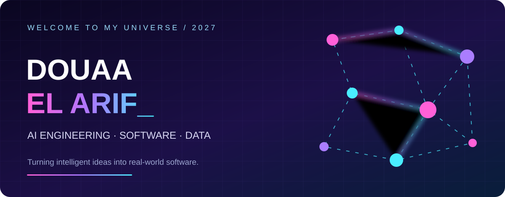
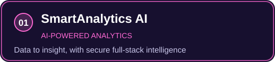
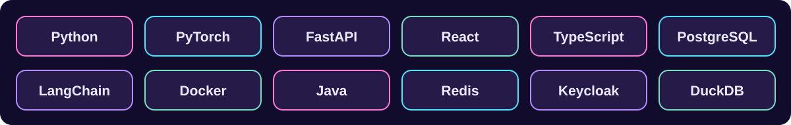

<!-- Neon Synthwave · Original animated SVG artwork, bundled in assets/ -->

<a href="https://www.linkedin.com/in/douaa-e-71413223b/">LinkedIn</a> &nbsp; ✦ &nbsp; <a href="mailto:elarifdouaa@gmail.com">Email</a> &nbsp; ✦ &nbsp; <a href="https://github.com/douaaelarif12?tab=repositories">Repositories</a>

## ✦ 01 / ABOUT ME

I'm **Douaa EL ARIF**, a final-year **Information & Communication Systems Engineering** student at **ENSA El Jadida, Morocco**, specializing in **Artificial Intelligence, Machine Learning and Software Engineering**.

I develop **end-to-end intelligent applications**, from data processing, graph neural networks and retrieval-augmented generation to reliable APIs, secure services and polished interfaces.

> 🎓 **Open to a 6-month PFE internship (January / February 2027)** — AI, ML, Generative AI, Data or Software Engineering. Open to opportunities in France, Morocco and internationally.

## ✦ 02 / FEATURED PROJECTS

<table><tr><td width="50%" valign="top">
Full-stack self-service analytics: CSV/XLSX ingestion, validated DuckDB queries, dashboards and an AI assistant delivering grounded analytical results.
<code>FastAPI · React · DuckDB · PostgreSQL</code></td><td width="50%" valign="top">
Hourly Citi Bike station-demand forecasting using spatial graphs and temporal modeling; evaluation of GCN, GAT and GCN-GRU architectures.
<code>PyTorch Geometric · NetworkX · ML</code></td></tr><tr><td valign="top">
Document question-answering assistant built using RAG, ChromaDB, Ollama and a ReAct-style reasoning workflow.
<code>Python · LangChain · ChromaDB</code></td><td valign="top">
Simulation of SAP access permissions, segregation-of-duties conflict detection, remediation tracking and GRC reporting.
<code>FastAPI · React · PostgreSQL · GRC</code></td></tr></table>

<a href="https://github.com/douaaelarif12?tab=repositories">Explore repositories →</a>

## ✦ 03 / TECH TOOLKIT

**AI & Data:** Scikit-learn · PyTorch Geometric · GNNs · RAG · Computer Vision · Analytics  
**Backend & Cloud:** Python · Java · Spring Boot · FastAPI · PostgreSQL · Redis · REST APIs  
**Frontend & Security:** React · TypeScript · Keycloak · RBAC · MFA · Git

## ✦ 04 / EXPERIENCE

**JESA — AI & Full-Stack Development (2026)** · Computer vision, YOLO11/OCR, React/TypeScript and backend APIs.  
**OCP Group — Backend & AI (2026)** · Java/Spring Boot services and RAG document assistant.  
**UM6P — AI & Cybersecurity (2025)** · Machine-learning experiments for intrusion detection with NSL-KDD.

## ✦ 05 / CONNECT

<a href="mailto:elarifdouaa@gmail.com">Email</a> · <a href="https://www.linkedin.com/in/douaa-e-71413223b/">LinkedIn</a> · <a href="https://github.com/douaaelarif12">GitHub</a>
Designed with curiosity. Engineered with intention. ✦

