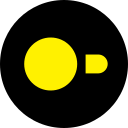
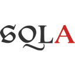

<!-- Original Showcase x Neon profile design. Authentic technology logos bundled locally. -->

  

  <a href="https://www.linkedin.com/in/douaa-e-71413223b/"><b>LinkedIn</b></a>
  &nbsp;&nbsp; • &nbsp;&nbsp;
  <a href="mailto:elarifdouaa@gmail.com"><b>Email</b></a>
  &nbsp;&nbsp; • &nbsp;&nbsp;
  <a href="https://github.com/douaaelarif12?tab=repositories"><b>Repositories</b></a>

---

## 01 / HELLO, I'M DOUAA ✦

I'm a final-year **Information & Communication Systems Engineering** student at **ENSA El Jadida, Morocco**, passionate about **AI, Machine Learning, Generative AI and Software Engineering**.

I build useful, secure and intelligent applications — from data pipelines, model training and RAG systems to reliable backends and full-stack platforms.

<table width="100%">
  <tr>
    <td width="33%" valign="top"><b>🎓 EDUCATION</b>
State Engineering Degree ENSA El Jadida
</td>
    <td width="33%" valign="top"><b>✨ WHAT I BUILD</b>
ML / Deep Learning GenAI · Data · Software
</td>
    <td width="34%" valign="top"><b>💜 OPEN TO WORK</b>
6-month PFE internship January 2027
</td>
  </tr>
</table>

## 02 / SELECTED PROJECTS

<table width="100%">
  <tr>
    <td width="50%" valign="top">
      <h3><a href="https://github.com/douaaelarif12/smartanalytics-ai">✦ 01 — SmartAnalytics AI</a></h3>
      <b>SELF-SERVICE ANALYTICS + GENAI</b>
      
Built a secure full-stack analytics platform for CSV/XLSX ingestion, dataset profiling, DuckDB queries, interactive dashboards and validated AI-assisted analysis.

      
 &nbsp;  &nbsp;  &nbsp; 

    </td>
    <td width="50%" valign="top">
      <h3><a href="https://github.com/douaaelarif12/citibike-gnn-lab-v2">✦ 02 — CitiBike GNN Lab</a></h3>
      <b>SPATIO-TEMPORAL GRAPH LEARNING</b>
      
Developed a leakage-safe forecasting pipeline and compared persistence baselines with GCN, GAT and GCN–GRU models for hourly station demand.

      
 &nbsp;  &nbsp;  &nbsp; 

    </td>
  </tr>
  <tr>
    <td width="50%" valign="top">
      <h3><a href="https://github.com/douaaelarif12/Industrial-PFD-Analysis">✦ 03 — Industrial PFD Analysis</a></h3>
      <b>COMPUTER VISION + DOCUMENT INTELLIGENCE</b>
      
Combined YOLO11, PaddleOCR, OpenCV and graph construction to analyze industrial Process Flow Diagrams through a FastAPI and React application.

      
 &nbsp;  &nbsp;  &nbsp; 

    </td>
    <td width="50%" valign="top">
      <h3><a href="https://github.com/douaaelarif12/5G-TwinAI">✦ 04 — 5G TwinAI</a></h3>
      <b>INTELLIGENT NETWORK DIGITAL TWIN</b>
      
Simulated a 5G network and integrated congestion prediction, anomaly detection, PPO-based optimization, FastAPI, WebSockets and a React dashboard.

      
 &nbsp;  &nbsp;  &nbsp; 

    </td>
  </tr>
  <tr>
    <td width="50%" valign="top">
      <h3><a href="https://github.com/douaaelarif12/VoiceScope">✦ 05 — VoiceScope AI</a></h3>
      <b>SPEECH + AUDIO INTELLIGENCE</b>
      
Built a local classroom-audio analysis platform combining speech detection, multilingual transcription, voice-profile comparison and structured exports.

      
 &nbsp;  &nbsp;  &nbsp; 

    </td>
    <td width="50%" valign="top">
      <h3><a href="https://github.com/douaaelarif12/ENSAJ-AI-Chatbot-RAG-Agentic-AI">✦ 06 — ENSAJ AI Assistant</a></h3>
      <b>RAG + AGENTIC WORKFLOWS</b>
      
Developed a local document assistant using LangChain, ChromaDB, Ollama and ReAct-style tools for contextual academic question answering.

      
 &nbsp;  &nbsp; 

    </td>
  </tr>
</table>

<a href="https://github.com/douaaelarif12?tab=repositories"><b>Explore my repositories →</b></a>

## 03 / TECH TOOLKIT

Real technology logos, grouped by specialty.

<h3>Languages</h3>
<table width="100%"><tr>
  <td align="center" width="16%" valign="middle"> <b>Python</b></td>
  <td align="center" width="16%" valign="middle"> <b>TypeScript</b></td>
  <td align="center" width="16%" valign="middle"> <b>JavaScript</b></td>
  <td align="center" width="16%" valign="middle"> <b>Java</b></td>
  <td align="center" width="16%" valign="middle"> <b>PHP</b></td>
  <td align="center" width="16%" valign="middle"> <b>C++</b></td>
</tr></table>

<h3>AI, ML & Data</h3>
<table width="100%"><tr>
  <td align="center" width="16%" valign="middle"> <b>PyTorch</b></td>
  <td align="center" width="16%" valign="middle"> <b>Scikit-learn</b></td>
  <td align="center" width="16%" valign="middle"> <b>NumPy</b></td>
  <td align="center" width="16%" valign="middle"> <b>Pandas</b></td>
  <td align="center" width="16%" valign="middle"> <b>LangChain</b></td>
  <td align="center" width="16%" valign="middle"> <b>Ollama</b></td>
</tr></table>

<h3>Backend & Databases</h3>
<table width="100%"><tr>
  <td align="center" width="16%" valign="middle"> <b>FastAPI</b></td>
  <td align="center" width="16%" valign="middle"> <b>Spring Boot</b></td>
  <td align="center" width="16%" valign="middle"> <b>PostgreSQL</b></td>
  <td align="center" width="16%" valign="middle"> <b>Redis</b></td>
  <td align="center" width="16%" valign="middle"> <b>DuckDB</b></td>
  <td align="center" width="16%" valign="middle"> <b>SQLite</b></td>
</tr></table>

<h3>Frontend & Engineering</h3>
<table width="100%"><tr>
  <td align="center" width="16%" valign="middle"> <b>React</b></td>
  <td align="center" width="16%" valign="middle"> <b>Vite</b></td>
  <td align="center" width="16%" valign="middle"> <b>Docker</b></td>
  <td align="center" width="16%" valign="middle"> <b>Git</b></td>
  <td align="center" width="16%" valign="middle"> <b>Google Cloud</b></td>
  <td align="center" width="16%" valign="middle"> <b>Keycloak</b></td>
</tr></table>

<h3>More tools</h3>
<table width="100%"><tr>
  <td align="center" width="16%" valign="middle"> <b>Pydantic</b></td>
  <td align="center" width="16%" valign="middle"> <b>SQLAlchemy</b></td>
  <td align="center" width="16%" valign="middle"> <b>NetworkX</b></td>
  <td align="center" width="16%" valign="middle"> <b>Jupyter</b></td>
  <td align="center" width="16%" valign="middle"> <b>Odoo</b></td>
  <td align="center" width="16%" valign="middle"> <b>Linux</b></td>
</tr></table>

**Also familiar with:** PyTorch Geometric · ChromaDB · YOLO11 · SQLAlchemy · Network Security · RBAC / MFA · REST APIs · Graph Neural Networks.

## 04 / EXPERIENCE

| Organization | Role & contributions |
|:--|:--|
| **JESA** · 2026 | **AI & Full-Stack Intern** — computer vision (YOLO11 / OCR), Python APIs and React / TypeScript interfaces |
| **OCP Group** · 2026 | **Backend & AI Intern** — Java / Spring Boot REST services and a RAG-powered document assistant |
| **UM6P** · 2025 | **AI & Cybersecurity Intern** — machine-learning intrusion detection experiments on NSL-KDD |

## 05 / LET'S CONNECT

I'm looking for a **6-month PFE internship starting January 2027** in **AI / ML, Generative AI, Data Engineering or Software Development**. Open to opportunities in Morocco, France and internationally.

  
  
<a href="mailto:elarifdouaa@gmail.com"><b>Contact me</b></a> &nbsp; · &nbsp; <a href="https://www.linkedin.com/in/douaa-e-71413223b/"><b>LinkedIn</b></a> &nbsp; · &nbsp; <a href="https://github.com/douaaelarif12"><b>GitHub</b></a>

  Curiosity in research. Care in engineering. ✦

